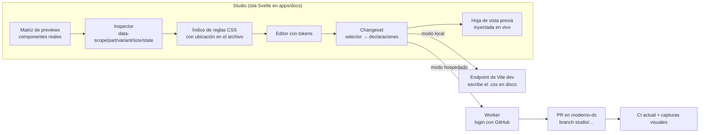

# Moderno Studio: edición visual de componentes

_Propuesta v1.1 · 22 de octubre de 2026 · estado: propuesta, pendiente de aprobar las decisiones de la sección 8_

## Respuesta corta

**Sí se puede, y Moderno ya tiene la base para que funcione en los 4 frameworks.**

Todo el aspecto visual de un componente vive en un solo archivo compartido: `packages/core/src/styles/components/<slug>.css`. React, Vue, Solid y Svelte generan el mismo marcado (`data-scope`, `data-part`, `data-variant`, `data-size`, `data-state`) y cargan esa misma hoja. El propio `Preview.astro` lo dice: _"one instance is the proof"_.

Por eso, un ajuste de padding, radio, color o tipografía hecho en el CSS compartido **se aplica a los 4 frameworks a la vez**, sin tocar código de ningún framework.

**La propuesta:** un modo **Studio** con el mismo inspector que te gustó en Cauce, pero conectado a ese CSS y a los tokens del contrato. Tú ajustas a ojo y Studio escribe el cambio en el archivo correcto, solo con tokens válidos. Luego lo entrega como Pull Request con capturas de antes y después. Sin abrir una conversación con Claude.

---

## 1. Qué se puede editar y qué no

| Capa                                          | Ejemplos                                                                                       | Archivo destino                                                                 | ¿Studio?                                                             |
| --------------------------------------------- | ---------------------------------------------------------------------------------------------- | ------------------------------------------------------------------------------- | -------------------------------------------------------------------- |
| **Estilo del componente**                     | padding, gap, alto, radio, borde, sombra, color de una parte, tipografía, opacidad, transición | `packages/core/src/styles/components/<slug>.css`                                | **Sí** (núcleo del plan)                                             |
| **Tokens del tema**                           | escala de espaciado, radios, colores del tema, tipos                                           | `registry/themes/<tema>/tokens.dtcg.json` o `packages/css/src/tokens.dtcg.json` | **Sí** (extiende el Theme Builder)                                   |
| **Marcado o comportamiento**                  | mover un ícono a otra parte, agregar una variante, cambiar props                               | código de cada framework                                                        | **No directo**: sale como issue `ready-for-agent`                    |
| **Blocks** (`registry/blocks/*/<framework>/`) | márgenes de un bloque con utilidades Tailwind                                                  | 4 archivos, uno por framework                                                   | **Fase posterior**: el cambio de clases se replica en los 4 archivos |

La regla que guía todo el plan: **Studio edita estilo, no estructura**. Cuando un ajuste necesita estructura, Studio no lo improvisa: lo deja documentado para el agente, con la captura y el selector.

---

## 2. Cómo se ve y cómo se usa

```
┌───────────────────────────────────────────────┬──────────────────────────┐
│  Button   [Variantes ▾] [Tamaños ▾] [Estados ▾] │  Inspector              │
│  Tema: moderno ▾   ☀/☾   Ancho: 360 · 768 · ∞  │  button › root          │
│                                               │  variant=solid size=md  │
│   ┌────────┐ ┌────────┐ ┌────────┐            │  ─────────────────────  │
│   │ Solid  │ │ Outline│ │ Ghost  │  sm        │  Aplicar a:             │
│   └────────┘ └────────┘ └────────┘            │  ○ Todas  ● Este tamaño │
│   ┌──────────┐ ┌──────────┐ ┌──────────┐      │  ○ Esta variante        │
│   │  Solid   │ │ Outline  │ │  Ghost   │  md  │  ─────────────────────  │
│   └──────────┘ └──────────┘ └──────────┘      │  Padding x  [spacing-3▾]│
│   (hover) (focus) (disabled) (open)           │  Alto       [spacing-7▾]│
│                                               │  Radio      [radius   ▾]│
│                                               │  Texto      [text-ui-sm]│
│                                               │  Fondo   primary · 100% │
├───────────────────────────────────────────────┴──────────────────────────┤
│  3 cambios · button.css   [Descartar]  [Ver diff]  [Crear PR]             │
└───────────────────────────────────────────────────────────────────────────┘
```

**Flujo:**

1. Abres `/studio/button` y ves la **matriz completa**: variantes × tamaños × estados, en claro y oscuro, con el tema que elijas y a varios anchos (también sirve para lo de márgenes y paddings en mobile que está en `todo/tasks.md`).
2. Haces clic en cualquier parte. El inspector muestra qué es (`button › root`, `variant=solid`, `size=md`) y **qué regla del CSS manda** en cada propiedad.
3. Ajustas con controles que **solo ofrecen tokens del contrato** (más detalle en la sección 3). Los cambios se ven al instante en toda la matriz.
4. Eliges el alcance: todas las variantes, solo este tamaño, solo esta variante o solo este estado. Studio escribe en la regla correcta, o crea la regla si no existe.
5. **Crear PR:** Studio arma el diff, corre los lints y abre el PR con capturas de antes y después. CI corre lo de siempre.

Lo que ya conoces del editor de Cauce se mantiene: selección con clic, padres e hijos con flechas, panel tipo Figma, hoja inferior en mobile y "Fijar cambios" (aquí, "Crear PR").

---

## 3. Ajustar "a ojo" sin romper el contrato

Moderno tiene reglas estrictas (`no-hardcoded-color`, `no-hardcoded-dimension`, CONTRACT.md). Studio las respeta desde la interfaz, no solo en CI:

| Propiedad            | Control                                                                | Lo que escribe                                                                              |
| -------------------- | ---------------------------------------------------------------------- | ------------------------------------------------------------------------------------------- |
| Espaciado, alto, gap | Escala `spacing-1…8` con vista previa en vivo, y "combinar" para sumas | `var(--spacing-3)` o `calc(var(--spacing-8) + var(--spacing-2))`, como ya hace `button.css` |
| Radio                | Tokens de radio                                                        | `var(--radius)` o sus variantes                                                             |
| Tipografía           | `text-ui-*` y `font-weight-*`                                          | tokens de texto                                                                             |
| Color                | Slot del contrato y porcentaje de mezcla                               | `color-mix(in oklch, var(--color-primary) 12%, transparent)`                                |
| Sombra, transición   | `shadow-*` y `motion-*`                                                | tokens                                                                                      |

**Arrastre fino:** si arrastras un padding, el valor salta al token más cercano y el resto de la escala se ve como marcas en la regla. Puedes soltarlo entre dos marcas; la vista previa muestra el valor exacto, pero el chip queda en ámbar: **"fuera de escala"**. Ese cambio no puede ir al PR así. Tienes tres salidas:

- **Ajustar al token** más cercano (un clic).
- **Componer** con `calc()` de tokens existentes.
- **Proponer token nuevo:** crea el token en el DTCG y marca el PR como `contract-change`. Esto toca el contrato, así que pide revisión especial (y quizá un ADR).

Así el "ojo de diseñador" tiene libertad para explorar, y lo que llega al repo sigue siendo 100 % contrato.

### 3.1 Propiedades que cubre el panel

Las partials ya usan mucho layout: `display` (144 veces), `align-items` (87), `justify-content` (51), `flex-direction` (50), `position` (45), `font-family` (37), `grid-template-columns` (17) e `inset` (13). Por eso el panel no se queda en padding y color.

| Grupo                  | Propiedades                                                                                                       | Control (estilo Figma)                                                                                                                | Fase |
| ---------------------- | ----------------------------------------------------------------------------------------------------------------- | ------------------------------------------------------------------------------------------------------------------------------------- | ---- |
| **Auto layout (flex)** | `display`, `flex-direction`, `align-items`, `justify-content`, `flex-wrap`, `gap`, `flex: 1` (rellenar o ajustar) | Dirección ↓ →, matriz de alineación 3×3, wrap, gap con token                                                                          | 1    |
| **Grid**               | `grid-template-columns` y `rows`, `place-items`, `gap`, `grid-column`                                             | Número de columnas, `repeat`/`minmax` con anchos en tokens, alineación                                                                | 1    |
| **Tamaño**             | `width`, `height`, `min`/`max`, `aspect-ratio`                                                                    | Fijo (token), rellenar o ajustar al contenido                                                                                         | 1    |
| **Espaciado**          | `padding`, `margin`, por lado o por eje                                                                           | Escala de tokens con candado de lados                                                                                                 | 1    |
| **Tipografía**         | `font-family`, `font-size`, `font-weight`, `line-height`, `letter-spacing`, `text-align`, `text-transform`        | Familia por slot (`--font-sans`, `--font-serif`, `--font-mono`), tamaño `text-ui-*`, peso `font-weight-*`, interlineado `--leading-*` | 1    |
| **Posición**           | `position`, `inset`/`top`/`left`, `z-index`, `transform: translate`                                               | Relativa, absoluta o sticky, con anclas a esquinas y desplazamiento en tokens (por ejemplo, el badge sobre la esquina de un avatar)   | 3    |
| **Orden visual**       | `order`, `flex-direction: *-reverse`                                                                              | Arrastrar partes dentro de su contenedor                                                                                              | 3    |
| **Apariencia**         | color, fondo, borde, radio, sombra, opacidad, transición                                                          | Slots del contrato y tokens                                                                                                           | 1    |
| **Responsive**         | reglas dentro de las container queries existentes (ADR-0005)                                                      | Alcance "solo a este ancho"                                                                                                           | 3    |

Los valores de layout son palabras clave (`center`, `row`, `grid`), así que no chocan con los lints. Las medidas dentro de ellos (anchos de columna, desplazamientos) siguen la regla de tokens de la sección 3.

**Familia tipográfica:** en el componente se elige el _slot_ (sans, serif o mono), nunca una fuente concreta. Cambiar la fuente real es un cambio del tema (`tokens.dtcg.json`), porque afecta a todo el sistema. `letter-spacing` no tiene token en el contrato hoy; en la v1 se ofrece solo `normal`, y un tracking propio va como "proponer token".

### 3.2 Reordenar: dos casos distintos

- **Orden visual dentro del mismo contenedor** (poner el ícono después del texto, invertir una fila): se resuelve con `order` o `*-reverse` en el CSS compartido y llega a los 4 frameworks. Studio avisa si el orden visual queda distinto del orden de lectura, porque eso afecta el teclado y los lectores de pantalla.
- **Mover una parte a otro contenedor o cambiar el orden real del marcado:** eso es estructura y vive en el código de cada framework. Studio deja hacer el arrastre como vista previa y lo envía con "Enviar al agente", con el antes, el después y la estructura objetivo, para que el cambio se haga igual en los 4.

---

## 4. Arquitectura



### 4.1 Piezas

- **Índice de reglas** (en build, con PostCSS): por cada `<slug>.css` genera la lista de reglas con su selector desglosado (scope, part, variant, size, state, pseudo), sus declaraciones y su ubicación en el archivo. Con eso el inspector sabe qué regla manda en cada propiedad del elemento que tocaste.
- **Selección:** desde el elemento clicado se sube hasta el `[data-part]` más cercano y se leen sus atributos `data-*`. Igual que en Cauce, pero el resultado es un selector de Moderno, no una ruta de DOM.
- **Estados forzados:** las partials usan `:hover` (50 veces), `:focus-visible` (61), `[data-disabled]`, `:disabled` y `[data-state="…"]`. Para mostrar todos los estados a la vez, la hoja de la matriz reescribe `:hover` como `[data-studio-hover]` (y lo mismo con focus). Los `data-state` se fijan pasando props a la demo (`open`, `checked`).
- **Changeset:** una lista de `{archivo, selector, propiedad, antes, después}`. Se guarda como borrador en el navegador por componente. Al aplicarlo se edita el AST de PostCSS **conservando comentarios y orden**: las partials tienen comentarios que explican decisiones, y el diff debe ser mínimo.
- **Validación previa:** antes de crear el PR, Studio corre `lint-core` (es TypeScript puro) sobre el archivo resultante. Si un cambio no pasa, no se puede enviar.
- **Tokens:** para tokens del tema se reutiliza el modelo del Theme Builder (`apps/docs/src/lib/theme.ts` y `@moderno-ui/theme-compile`). Studio solo agrega la vista "qué componentes usan este token" antes de cambiarlo, porque un token toca muchos componentes a la vez.

### 4.2 Dos formas de guardar, misma interfaz

|               | **Modo local** (`pnpm studio`)                                                    | **Modo hospedado** (`studio.moderno…`)                                                                                                           |
| ------------- | --------------------------------------------------------------------------------- | ------------------------------------------------------------------------------------------------------------------------------------------------ |
| Dónde corre   | El dev server de docs en tu máquina                                               | Un build aparte de docs con `STUDIO=1` en Cloudflare Workers (o Vercel)                                                                          |
| Cómo guarda   | Un endpoint del dev server escribe el `.css` en disco; HMR lo muestra al instante | Un Worker crea branch, commit y PR con la API de GitHub                                                                                          |
| Autenticación | Ninguna (es tu máquina)                                                           | Login con GitHub (GitHub App, token de usuario). Solo entra quien tenga permiso de escritura en el repo. Opcional: Cloudflare Access por encima. |
| Para qué      | Iterar rápido, en sesiones largas de pulido                                       | Editar desde cualquier lugar, incluso desde el iPad, sin clonar nada                                                                             |
| Resultado     | Cambios locales que commiteas tú                                                  | PR con capturas, listo para revisar                                                                                                              |

**El sitio público de docs no cambia:** la ruta `/studio` y su código solo existen en el build con `STUDIO=1`. GitHub Pages sigue publicando el sitio estático de siempre.

**Seguridad del modo hospedado:**

- el Worker solo puede escribir en `packages/core/src/styles/components/**` y en los `tokens.dtcg.json`, y solo en branches `studio/*`;
- nunca escribe en `main`;
- el PR queda a nombre de quien hizo login.

---

## 5. Del cambio al PR

1. **Diff mínimo** sobre el `.css` (o el DTCG).
2. **Checks locales en Studio:** `lint-core` y "fuera de escala" en cero.
3. **Commit** en `studio/<slug>-<fecha>`, con mensaje `style(<slug>): …` generado a partir del changeset.
4. **PR con:**
   - tabla de cambios (selector, propiedad, antes y después);
   - capturas de antes y después de la matriz en claro y oscuro;
   - etiqueta `studio`, y `contract-change` si propone tokens.
5. **CI de siempre:** `pnpm gen --check`, `lint:registry`, `theme:build` + `git diff --exit-code`, `docs:parity`, `agent:check-drift`, `typecheck`, `test`, `docs:e2e`.
6. **Nuevo check visual** (fase 4): Playwright toma la matriz del componente en los **4 playgrounds** (`packages/*/playground`) y compara contra la base. El CSS es uno solo, pero el marcado no siempre: si un framework no pone un `data-part`, el ajuste no le llega, y esto lo detecta.

**Para lo que no es CSS:** el botón "Enviar al agente" crea un issue con:

- captura;
- selector;
- tu nota ("el ícono debería ir dentro del label");
- etiqueta `ready-for-agent`.

Esto encaja con el flujo de tickets que ya usan el repo y `.claude/workflows/dispatch-epic.js`.

---

## 6. Fases

| Fase                                  | Alcance                                                                                                                                                                                            | Listo cuando                                                                                                      |
| ------------------------------------- | -------------------------------------------------------------------------------------------------------------------------------------------------------------------------------------------------- | ----------------------------------------------------------------------------------------------------------------- |
| **0 · Prueba de concepto** (1–2 días) | Índice de reglas y selección, solo para `button`                                                                                                                                                   | Clic en un botón muestra la regla exacta que manda en su padding, con su ubicación en el archivo                  |
| **1 · Studio local**                  | `pnpm studio`, matriz de variantes × tamaños × claro/oscuro, inspector, controles con tokens (espaciado, radio, texto, color), alcance del cambio, escritura en disco con HMR, `lint-core` en vivo | Pulir `button`, `badge` y `field` de punta a punta sin editar CSS a mano, y que CI pase sin cambios               |
| **2 · Studio hospedado**              | Build con `STUDIO=1`, Worker, login con GitHub, PR con tabla y capturas, borradores                                                                                                                | Desde otro computador o iPad, un ajuste termina en un PR verde                                                    |
| **3 · Estados, anchos y tokens**      | Estados forzados, anchos (360 / 768 / contenedor), posición, orden visual, alcance "solo a este ancho", editar tokens del tema con "qué usa este token", proponer token nuevo                      | Corregir paddings en mobile y estados `hover`/`focus` de 5 componentes; un token nuevo pasa por `contract-change` |
| **4 · Regresión visual**              | Capturas en los 4 playgrounds dentro de CI y comparación con la base                                                                                                                               | Un PR que rompe la paridad en un framework falla con la captura del problema                                      |
| **5 · Opcional**                      | "Enviar al agente"; edición de blocks (cambios de clases replicados en los 4 archivos); "Sugerir pulido" con Claude dentro de Studio (propone un changeset que tú aceptas o descartas)             | —                                                                                                                 |

**MVP recomendado: fases 0 y 1.** Con eso ya dejas de depender de una conversación para pulir componentes. La fase 2 agrega la comodidad de hacerlo desde cualquier lugar.

---

## 7. Riesgos y cómo manejarlos

| Riesgo                                                           | Mitigación                                                                                                                                                                              |
| ---------------------------------------------------------------- | --------------------------------------------------------------------------------------------------------------------------------------------------------------------------------------- |
| Editar el CSS con PostCSS reformatea o borra comentarios         | Edición quirúrgica: solo se cambia el valor de la declaración o se inserta en la regla existente, y hay tests de ida y vuelta (parsear y escribir = mismo archivo) para las 47 partials |
| La cascada es confusa (base, variante, tamaño y estado compiten) | El inspector muestra todas las reglas que aplican y cuál gana, como DevTools, y el alcance del cambio es explícito                                                                      |
| Cambiar un token cuando querías cambiar solo un componente       | Los tokens viven en otra pestaña con la lista de componentes afectados; por defecto se edita el componente                                                                              |
| Un framework no emite el mismo `data-part`                       | `docs:parity` y el check visual de la fase 4                                                                                                                                            |
| PRs de Studio que chocan entre sí                                | Un branch por componente; si ya hay un PR abierto de `studio/<slug>`, Studio agrega commits a ese mismo                                                                                 |
| Endpoint con permiso de escritura expuesto                       | Token de usuario de GitHub App, rutas permitidas cerradas, solo branches `studio/*` y Cloudflare Access opcional                                                                        |
| Archivos generados (`pnpm gen`)                                  | Studio nunca edita generados; si un cambio los afecta, CI lo detecta con `gen --check`                                                                                                  |

---

## 8. Decisiones abiertas (para ti)

1. **¿Hospedado en Cloudflare Workers o en Vercel?** Recomiendo Cloudflare por el Worker y Access, que ya conoces.
2. **¿El PR a tu nombre (token de usuario) o a nombre de la app con `Co-authored-by`?** Recomiendo a tu nombre.
3. **¿Proponer tokens nuevos desde Studio en la v1, o solo ajustar a los existentes?** Recomiendo solo existentes en la v1; proponer tokens en la fase 3.
4. **¿Dónde va en el repo?** Sugerencia:
   - este plan como PRD en `docs/prd/moderno-studio.md`;
   - un ADR-0013 ("Studio edita estilo compartido, no estructura");
   - los issues por fase con la skill `to-issues` del repo.

---

## 9. Issues sugeridos (borrador)

- `studio-0` Índice de reglas CSS por componente (PostCSS, con ubicaciones) y test de ida y vuelta para las 47 partials
- `studio-1a` Ruta `/studio/[slug]` solo con `STUDIO=1` y matriz de variantes × tamaños × tema
- `studio-1b` Inspector: selección por `data-part`, reglas que aplican y regla ganadora
- `studio-1c` Controles con tokens (layout, tamaño, espaciado, tipografía, apariencia) y aviso "fuera de escala"
- `studio-1d` Changeset con hoja de vista previa en vivo y borradores
- `studio-1e` Escritura en disco en modo dev y `lint-core` previo
- `studio-2a` Worker con login GitHub, rutas permitidas y branch/commit/PR
- `studio-2b` Capturas de antes y después en el PR
- `studio-3a` Estados forzados (`:hover` y `:focus-visible` reescritos) y props de estado
- `studio-3b` Posición, orden visual y alcance "solo a este ancho"
- `studio-3c` Pestaña de tokens con "qué usa este token" e integración con el Theme Builder
- `studio-4a` Regresión visual en los 4 playgrounds dentro de CI
- `studio-5a` "Enviar al agente": issue `ready-for-agent` con captura y selector
